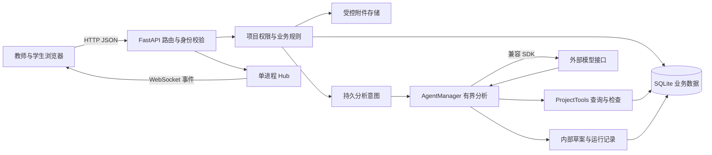
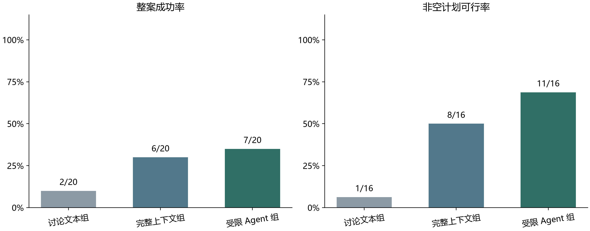
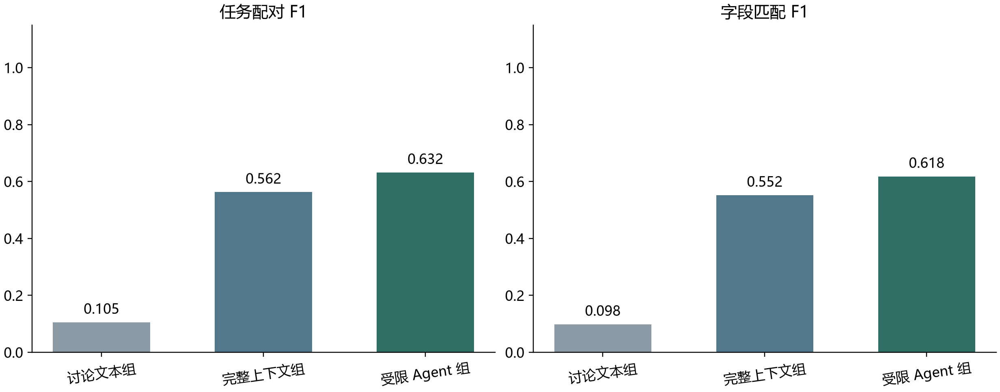
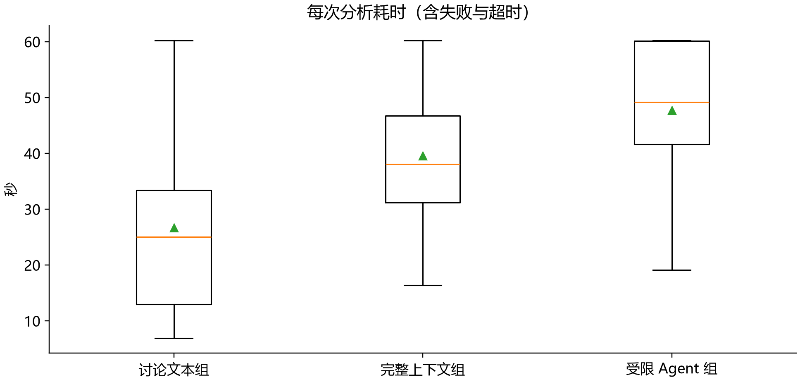
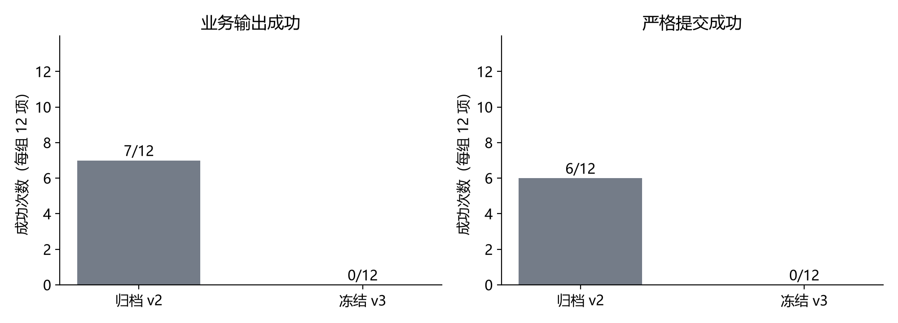
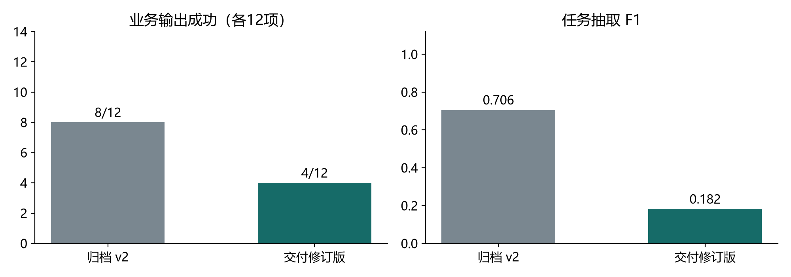

# 基于大语言模型 Agent 的课程项目智能协作系统设计与实现

通用计算机类本科毕业论文初稿。首次编制：2026 年 10 月 15 日；本次修订：2026 年 10 月 18 日。本文依据当前代码、需求与设计资料、已保存测试记录撰写，未填写学校、作者和指导教师等未知信息。文中架构图、数据图和时序图均为依据实现绘制的示意图。

## 摘要

课程项目通常以小组为单位完成需求分析、任务分工、开发实施与阶段验收。讨论中形成的承诺、依赖和时间调整需要转化为可执行记录，普通聊天工具与任务看板之间的人工整理容易造成信息遗漏，单次大语言模型问答又缺少项目最新状态与发布约束。针对这一问题，本文设计并实现课程项目智能协作系统，将大语言模型 Agent 嵌入学生团队的日常讨论与计划核对过程。

系统采用 FastAPI、SQLAlchemy、SQLite 与 Vue 3，围绕教师、项目组长和成员构建课程要求、项目需求、任务执行、计划版本及三个检查阶段的协作流程。Agent 通过绑定当前项目的只读查询与规划检查工具获得业务上下文，在限定轮次与超时内生成追问、规划或调整草案。服务端对输出执行结构校验、来源校验与完整任务集合的约束检查，由组长确认后在同一事务中发布任务变更和计划快照。针对后台分析中断与重复操作，系统独立持久化分析意图，并结合项目修订号、消息幂等标识和发布结果关联保存处理进度。

功能测试覆盖权限隔离、消息补漏、草案发布、计划历史和异常恢复，后端217项与前端43项通过，并在同机全新Python依赖及node_modules下复核。历史60项评价和兼容修复前的24项评价保留失败与版本。交付修订另用六个冻结新样例、两组、每例两次重复，完成24项分析、46次真实模型请求。归档v2与交付修订版的业务输出成功数分别为8/12、4/12，严格提交成功数为6/12、0/12。主指标与原始协议规范分别解释，结果受合成样例、有限语法和小样本限制，不能证明单一工具的因果收益、统计显著或学习效果。研究贡献属于课程协作的系统集成与一致性控制，长期使用仍待验证。

关键词：大语言模型；智能体；课程项目；协同工作；约束检查；计划版本

## Abstract

Course projects require student teams to translate discussions about requirements, responsibilities, dependencies, and delays into consistent project records. Manual transfer between chat tools and task boards can omit relevant information, while a standalone language model response may lack current project state and operational constraints. This thesis designs and implements an intelligent collaboration system that integrates a large language model agent into daily student teamwork.

The system uses FastAPI, SQLAlchemy, SQLite, and Vue 3. It supports teachers, project leaders, and members through course requirements, task execution, versioned plans, and three review stages. The agent obtains context through project-bound read and validation tools and produces clarification questions or draft changes within a bounded execution loop. The server validates output structure, message provenance, project references, and constraints over the full task set. A leader then explicitly publishes validated changes and an immutable plan snapshot in one transaction. Persistent analysis intents, revision checks, message identifiers, and stored publication results support recovery and idempotent operations.

Functional verification passed 217 backend and 43 frontend tests, and an isolated environment with newly installed Python and frontend dependencies reproduced the checks on the same Windows machine. The historical sixty-case evaluation and the twenty-four analyses before the compatibility fix retain their failures and source snapshots. A separate frozen follow-up used six new cases, two conditions, and two repetitions, completing 24 analyses and 46 actual model requests. Business-output success was 8/12 for archived v2 and 4/12 for the delivered revision, while strict-submission success was 6/12 and 0/12. The functional outcome and raw protocol compliance are interpreted separately. Synthetic cases, conservative grammar, and small samples prevent causal, statistically significant, or educational-effect claims. The contribution is an engineering integration with traceable changes, and long-term use remains unverified.

Keywords: large language model; agent; course project; collaboration; constraint validation; plan versioning

## 第 1 章 绪论

### 1.1 研究背景

课程软件项目的产出既包括最终代码与报告，也包括需求澄清、成员分工、问题处理和阶段反馈等过程信息。以实现一个 Web 应用为例，成员可能在讨论中提出登录功能的验收条件，随后调整开发工时，并说明数据库接口延期影响前端联调。上述信息分散在连续消息中，只有转化为需求、任务、依赖和时间安排，才便于团队继续执行。若只保留聊天记录，后续成员需要重新阅读上下文；若只保留任务列表，任务为何变化、基于哪条讨论又难以解释。

本项目需求资料将普通成员的持续协作作为主要使用场景。成员应当能直接推进本人任务、记录阻碍和提交成果，组长负责整体分工与计划确认，教师依据课程要求、阶段材料和结构化进度指导项目。这意味着系统不能把所有日常更新都变成逐级审批，也不能把教师的监督权限扩大到团队内部讨论。协作便利、过程可追踪与访问边界必须同时考虑。

大语言模型可以理解自然语言并生成结构化建议，为讨论到项目记录的转化提供了实现途径。不过，语言表达流畅不等于项目事实正确。模型可能猜测负责人、错误理解相对日期，或只调整当前任务而忽略已有依赖。若直接将模型输出写入正式计划，一次错误推断就可能影响多个成员。因此，本研究关注如何把模型嵌入可检查、可核对、可恢复的业务流程，使生成内容与最终生效操作之间具有明确边界。

### 1.2 相关研究与技术现状

围绕大语言模型智能体的研究，ReAct 将推理与环境行动交替组织，使模型能够通过外部信息继续完成任务。其意义在于生成过程可以与环境反馈交互，而不必完全依赖一次性提示。本文借鉴这种交互思路，将项目查询和约束检查作为有限工具，但没有复现原论文全部任务、训练条件和基准结果，也不将系统中的普通日志解释为模型内部推理过程。[1](https://arxiv.org/abs/2210.03629)

Toolformer 探索通过自监督方式训练模型选择 API、构造参数并利用返回结果。该工作说明工具使用本身可以成为语言模型能力研究的对象。本文调用已部署的兼容接口，未训练工具调用模型，因此工具白名单、参数校验和执行预算属于应用侧约束，不能声称实现了 Toolformer 的训练方法。[2](https://arxiv.org/abs/2302.04761)

Wang 等对大语言模型自主智能体的构造、应用与评价进行了综述，提示智能体研究需要同时分析系统组成与评价方法。Shinn 等提出的 Reflexion 使用语言反馈与记忆影响后续尝试。本文的有限修正仅将规划检查结果返回同一轮业务分析，不保存跨任务反思记忆，也不更新模型参数，故与上述学习框架具有不同范围。[3](https://arxiv.org/abs/2308.11432v1) [4](https://arxiv.org/abs/2303.11366)

从课程协作需求看，通用的任务列表擅长保存明确事项，聊天界面便于交流，生成式模型便于解释自然语言。本文要处理的是这些能力之间的工程衔接：讨论需要真实出处，计划需要结构约束，权限需要以项目成员关系判断，后台分析还需要承受网络故障和服务重启。本文不对市面产品作覆盖性比较，也没有基于未调查的用户群体声称现有工具普遍无效。

### 1.3 研究目标与工作内容

本研究的目标是完成一个可运行、可追溯的课程项目协作原型。系统使成员在讨论和任务执行之间连续工作，使 Agent 在充分信息下提出草案，并使教师通过阶段成果履行指导职责。主要工作包括领域需求与权限建模、前后端业务实现、受限 Agent 工具集设计、规划约束检查、发布一致性控制和测试评价资料整理。

工程上有三个重点。其一，将课程要求、已确认需求、成员容量、现有任务和待核对卡片统一为当前项目上下文，减少建议脱离业务状态的可能。其二，将草案与正式计划分离，对完整任务集合进行检查，再由有权限的人员发布。其三，将分析意图与聊天游标分开保存，使没有新增聊天的任务进度变化也能触发可恢复分析。三个重点互相配合，分别解决信息依据、业务生效和后台可靠性问题。

本文的工作属于既有模型、Web 技术与领域规则的组合实现。没有提出新的基础模型、最优排程算法或自动评分模型。关于工具反馈是否提高草案可用性，需要通过固定样例与一致口径验证；关于教学价值，则需要真实课程部署和合规的用户研究，超出当前原型证据范围。

### 1.4 论文结构

第 2 章说明系统采用的技术和方法；第 3 章分析角色、业务及非功能需求；第 4 章给出架构、数据和交互设计；第 5 章阐述关键实现；第 6 章报告功能测试并定义比较方法；第 7 章接入固定评价的实际结果；第 8 章总结工作、局限与后续方向。附录给出源码与证据索引，支持对论文中的实现陈述进行复核。

## 第 2 章 相关技术与方法

### 2.1 大语言模型 Agent 与受限工具调用

本文将 Agent 定义为在业务输入、项目状态、工具反馈和输出协议之间执行有限交互的软件模块。模型负责解释讨论与组织建议，应用程序负责选择允许的数据、执行工具和决定哪些操作能够落库。这里的自主性主要表现为主动追问、选择查询或检查工具、根据反馈修正草案；正式计划的发布仍由组长操作。

这种分工避免把自然语言提示当作唯一约束。提示可以告诉模型不要跨项目访问，但真正的隔离来自工具实例绑定的项目标识。提示可以要求日期合理，但日期与依赖的确定性检查由程序实现。模型输出具有不确定性，业务规则则应当在相同输入下给出可复核结果。两者在系统中分别承担语义解释与状态约束职责。

### 2.2 FastAPI 与数据校验

FastAPI 使用类型声明与 Pydantic 模型描述请求数据，并提供依赖注入机制。系统利用请求模型约束日期、枚举、文本长度和数值范围，通过依赖获得数据库会话及当前用户。该技术选型便于在接口边界集中处理格式错误，但业务权限仍需要显式代码，不能由类型校验自动推导。[8](https://fastapi.tiangolo.com/tutorial/body/) [9](https://fastapi.tiangolo.com/tutorial/dependencies/)

Pydantic 的模型机制用于将输入转换并校验为已声明结构。当前项目的公共载荷基类禁止额外字段和非有限浮点数，Agent 最终输出也经过模型验证。结构通过只表示字段满足协议，例如一个合法整数仍可能引用其他项目用户，所以系统继续执行来源、资源归属和规划规则检查。[12](https://pydantic.dev/docs/validation/latest/concepts/models/)

### 2.3 SQLAlchemy、SQLite 与事务

SQLAlchemy ORM 将领域对象映射到数据库表，Session 组织对象读写及事务。系统在一项业务操作中收集任务变更、审计、计划快照和关联状态，最后统一提交；异常时回滚尚未提交的数据库修改。官方 Session 文档强调明确事务与会话生命周期，本文以请求会话和后台短会话实现这一原则。[11](https://docs.sqlalchemy.org/en/20/orm/session_basics.html)

SQLite 适合本原型的单机演示部署，减少独立数据库服务的运维负担。SQLite 文档说明写入需要串行协调，因而本文不据此宣称高并发或分布式能力。当前连接启用外键检查与等待超时，后台广播和分析调度采用单进程内存状态；迁移到多实例时仍需独立的消息基础设施和并发任务协调。[13](https://www.sqlite.org/isolation.html)

### 2.4 Vue 3 与前端状态管理

Vue 3 的组合式 API 允许通过导入函数组织响应式状态及生命周期逻辑，单文件组件则组织页面模板、脚本和样式。项目将接口、会话、项目数据和实时连接集中在工作区模块，将任务详情、草案编辑、附件和阶段审核拆分为组件，减少页面之间重复维护同一份业务状态。[10](https://vuejs.org/guide/extras/composition-api-faq.html)

响应式更新还带来异步一致性问题。例如用户切换项目后，前一次请求可能较晚返回；队友触发刷新时，本地尚未保存的表单可能被覆盖。因此，系统通过会话作用域编号、加载版本和独立表单快照保护用户当前操作。前端这些措施改善交互一致性，服务端权限与版本检查仍作为最终判定依据。

### 2.5 HTTP、WebSocket 与身份令牌

系统以资源为中心组织 HTTP 路径，并使用 JSON 交换数据。Fielding 的论文给出了 REST 架构风格的约束背景；本文接口借鉴资源化表达，但未实现超媒体驱动等全部 REST 约束，故将其称为资源化 HTTP API 更为准确。[5](https://ics.uci.edu/~fielding/pubs/dissertation/top.htm)

WebSocket 提供客户端与服务端的持续双向通信机制。当前系统将可靠的业务写入放在 HTTP 请求中，以实时连接接收消息、卡片变化及项目状态事件，断线后再通过历史接口补齐。WebSocket 本身不保证数据库持久化或业务去重，这些语义由应用实现。[6](https://www.rfc-editor.org/rfc/rfc6455)

JSON Web Token (JWT) 是承载声明的标准化形式。系统使用签名令牌表示登录身份，校验有效期和用户状态；项目角色则从数据库读取。签名令牌并不自动授予某个项目权限，也不应存放模型密钥或内部讨论内容。[7](https://www.rfc-editor.org/rfc/rfc7519)

## 第 3 章 需求分析

### 3.1 业务边界与角色

系统服务于一门课程下的多个学生团队。课程任务由教师发布，团队依据课程任务建立项目，成员在各自项目内协作。账号身份区分教师与学生，学生在具体项目中再区分组长和成员。同一学生可以参加多个项目，不能因为其在另一个项目中担任组长而获得当前项目权限。

教师需要管理自己发布的课程要求，查看关联团队的需求、任务、已发布计划、进度和阶段材料。教师不进入学生聊天室，不读取原始消息、内部分析卡片和 Agent 运行记录，也没有与团队 Agent 私聊的功能。该边界与需求规格中的权限矩阵一致，目的在于使阶段指导围绕已形成的业务结果进行。

组长负责项目建立、邀请成员、整理需求、协调分工、确认计划以及组织阶段提交。成员负责维护本人技能和当前项目周容量，参与讨论、反馈草案、推进本人任务、记录阻碍与提交成果。Agent 负责提供分析和建议，没有独立账号权限，也不能直接执行正式计划发布。

### 3.2 核心功能需求

课程任务包含背景、必做与选做功能、参考资料、验收标准和三个检查阶段。发布前必须具备必要说明、必做功能和阶段交付要求，阶段截止日期严格递增。课程公开要求调整后需要保留版本与历史，并使依据旧状态生成的未发布草案重新核对。

团队需求是课程要求在本项目中的细化，包含名称、说明、优先级、验收条件与关联课程功能。成员可以提出和补充需求，组长负责确认。已确认需求为任务规划提供结构化依据。仅有任务名称不足以表示覆盖，任务需要显式关联需求，需求再关联课程必做功能。

开发任务包含负责人、预计与剩余工时、日期、阶段、依赖、状态、进度、成果和阻碍。成员可直接更新本人任务的执行字段；调整负责人、任务说明、依赖和整体排期等规划字段由组长完成。阻碍记录独立于任务状态，任务可以在进行中同时存在阻碍，避免将等待协助误解为一个互斥的完成阶段。

聊天室保存带作者和时间的讨论，允许关联真实任务、需求或卡片。发送后应能获得持久化确认，网络重试不能生成重复消息。成员重连后能够补齐缺失历史。人类消息入库与模型分析分开进行，模型超时不应阻塞团队继续交流。

Agent 分析应当识别需要澄清的事项，在必要信息不足时提出具体问题，而不是编造负责人、工时或时间。可形成规划时生成包含来源与检查结果的草案；新信息修正旧结论时保留替代关系。延期分析需要结合当前任务状态和依赖关系，不因一条聊天消息就改变教师截止日期或已完成记录。

### 3.3 三阶段检查需求

系统将课程检查划分为需求与计划、开发中期、最终验收三个阶段。第一个阶段关注必做功能覆盖、需求清晰度和分工排期；第二个阶段关注进度、主要阻碍和后续安排；第三个阶段关注最终代码、报告、测试及演示材料。三个阶段共享提交与审核机制，同时保留各自日期和交付物要求。

阶段提交由组长发起，关联本次成果链接或已上传文件，并保存当时计划版本与进度快照。教师给出通过或需要修改的结论，并填写意见。团队重新提交时形成新版本，旧材料和旧意见继续保留。阶段通过不是把全部任务自动标记为完成；需要修改也不自动冻结成员的日常任务更新。

### 3.4 关键业务约束

系统必须同时遵守空间边界、时间边界和操作边界。空间边界要求任务负责人、需求、依赖和消息来源均属于当前项目。时间边界要求日期有效、任务不超过所属阶段，后续未完成任务在前置任务截止日之后开始。操作边界要求模型生成与业务发布分离，普通成员无法发布整体计划，失效草案不能直接生效。

可投入时间只使用成员明确维护的当前项目周容量，不读取个人日程或其他项目私有任务。完成比例只表示已完成任务数占比，不代表课程功能验收率或个人贡献分。上述口径决定系统统计属于项目管理辅助信息，不能直接用于自动评分。

### 3.5 非功能需求

一致性要求一次发布不能只创建部分任务，重复发布不能增加版本，旧分析不能覆盖新核对结果。可恢复性要求业务提交后即使广播或模型调用中断，也能区分已提交结果与未处理意图。可追踪性要求记录来源、修改者、时间、发布结果与必要审计，而不是仅保存模型的最终一句结论。

安全性要求在 HTTP、实时连接、附件下载和工具调用处分别校验权限。凭据只由服务端配置读取，不通过配置状态接口返回。错误信息避免回显密码或供应商异常中可能包含的敏感参数。当前原型只证明指定测试范围内的访问控制行为，未进行全面渗透测试。

交互方面需要提供个人工作台、讨论与卡片区、任务看板、计划比较和阶段历史，清楚显示待处理事项和失败状态。可维护性方面采用路由、领域规则、模型提供者和前端状态分离，避免把规划规则散落在页面中。当前版本支持单机演示和可重复测试，不将高可用、多实例调度或大规模并发作为已完成功能。

### 3.6 需求与验证对应关系

| 需求组 | 主要实现 | 核心验证观察 |
| --- | --- | --- |
| 账号与资源隔离 | 用户依赖、项目权限函数、受控序列化 | 其他项目及教师内部访问返回拒绝 |
| 成员日常协作 | 本人任务更新、评论、容量与成果 | 执行字段可更新，规划字段受角色约束 |
| 可靠讨论 | HTTP 入库、唯一客户端标识、历史游标 | 重试不重复，重连不跳过历史 |
| Agent 分析 | 项目绑定工具、有界循环、结构协议 | 非法来源拒绝，失败保留可重试记录 |
| 草案与发布 | 完整集合检查、修订校验、事务快照 | 失效拒绝，重复返回原发布结果 |
| 阶段交付 | 版本提交、材料映射、教师审核 | 重提与旧审核历史并存 |

## 第 4 章 系统设计

### 4.1 总体架构

系统采用浏览器、应用服务、持久化存储与外部模型接口四个部分。浏览器展示角色允许的工作区，通过 HTTP 进行业务读写，通过 WebSocket 接收变化事件。FastAPI 应用统一执行身份、资源权限和业务规则。SQLAlchemy 管理数据库对象，SQLite 保存结构化记录，本地受控目录保存附件。外部模型接口只服务于 Agent 分析，不成为任务或计划的直接写入者。

应用服务内部划分路由、业务规则、领域数据、实时广播和 Agent 管理模块。路由负责输入与角色验证，规划模块提供共享的确定性检查，Agent 管理模块负责意图、消息聚合、调用预算与恢复。人工创建草案与模型草案复用同一规划检查，减少两条路径规则不一致的问题。图 4-1 为架构示意，源文件为 `图源/图4-1-系统架构.mmd`。

### 4.2 功能模块设计

课程与团队模块保存课程要求、阶段配置、项目成员和当前项目容量。需求模块把课程功能转为确认后的需求条目。任务模块支持规划信息与日常执行记录，并为看板、工作台和教师进度页面提供统一数据。协作模块将讨论、任务评论和草案反馈连在一起，保留每项建议的来源与核对过程。

计划模块不只保存最新日期，而是将发布时的完整任务集合写为版本快照，同时保存变更前后内容。阶段模块关联当时计划和进度，避免教师以后查看旧提交时读到已变化的当前状态。Agent 模块从这些数据中读取允许的上下文，输出待核对建议；它依赖业务模块，却不绕过业务模块的发布入口。

### 4.3 数据模型设计

当前 ORM 包含 15 张核心数据表，分别表示用户、课程、项目、项目成员、需求、任务、评论、消息、卡片、计划、阶段提交、附件、审计、Agent 运行记录与 Agent 处理意图。任务依赖、卡片反馈和提交审核等内容以实体中的 JSON 字段存储。图 4-2 使用简化实体图，只保留主要归属和业务关联，不把 JSON 数组画成独立关系表。

用户与项目之间通过成员表关联，成员关系拥有唯一的项目与用户组合。项目关联一门课程，课程由教师拥有。需求、任务、消息、卡片、计划、阶段提交、附件和运行记录都带项目归属。任务引用需求与负责人，其依赖列表保存本项目任务标识。数据库外键负责基本引用完整性，同项目引用、成员身份与依赖语义由业务检查保证。

| 物理表 | 关键字段或约束 | 设计用途 |
| --- | --- | --- |
| users、courses | 用户身份；教师标识、课程状态和版本 | 账号与课程公开边界 |
| projects、members | revision、analyzed_message_id；项目用户唯一组合 | 版本控制、处理游标和项目角色 |
| requirements、tasks | 确认状态、课程功能；需求、负责人、工时、日期和依赖 | 需求到可执行任务的结构关联 |
| comments、messages | 任务评论；项目/用户/client_id 唯一组合 | 日常协作及发送幂等 |
| cards、plans | base_revision、published_plan_id；项目版本唯一组合 | 草案与正式快照分离 |
| submissions、files | 阶段版本唯一组合、材料和快照；存储名和项目 | 阶段历史与受控附件 |
| audit、agent_runs、agent_intents | 操作者和变更；模型运行；模式和状态 | 审计、可用性与处理恢复 |

计划与提交的快照使用 JSON 保存当时字段，不在读取历史时重新拼接当前任务。该方案便于原型查询和版本比较，但大规模分析、字段级索引与长期迁移的灵活性有限。未来若增加跨学期统计，可将高频查询字段进一步规范化，同时保留不可变快照语义。

### 4.4 角色与数据访问设计

权限判定首先验证账号身份与状态，再检查课程或项目归属。教师访问项目时，必须是对应课程的教师，且请求不能标记为内部协作或组长操作。学生访问项目时，必须存在当前项目成员记录；需要发布计划时，成员角色还必须为组长。工具查询同样要求关联课程处于公开状态，防止异常历史关联泄漏教师草稿。

附件权限按业务用途细分。学生只能在本项目上传和枚举内部附件；教师只允许读取已进入阶段提交的附件。文件名用于展示，实际路径由服务端生成随机存储名。下载时重新确认目录边界，避免用户提交任意磁盘路径。该设计把“文件属于项目”与“文件已提交给教师”区分开，维持阶段交付边界。

### 4.5 草案状态与发布设计

卡片保存讨论、规划或调整建议，具有待核对、可发布、已发布、已拒绝、已失效和失败等状态。包含未解决问题时不能发布；没有任务的讨论卡也不会自动成为计划。草案生成时保存项目修订号，相关业务发生变化后，旧卡片需要重新核对。卡片修改会撤销旧反馈的确认标记，以免把先前确认错误地套用于新内容。

正式发布遵循“权限、幂等、版本、来源、约束、事务”顺序。先检查当前用户是否为本项目组长，再查询已有发布结果；已发布草案直接返回原计划。尚未发布时，校验基础修订号和卡片状态，确认来源与任务完整性，再执行完整集合约束检查。之后通过条件更新增加项目修订号，写入任务、快照、审计和发布关联，最后提交事务。任一步骤失败均不应保留部分正式计划。

成员反馈用于保留核对意见，但当前发布接口未强制每个负责人逐一确认。前端的最终确认与服务端组长权限共同构成发布入口；论文不能把成员意见记录描述成已实现的全员签署机制。这一区分既符合当前代码，也便于后续根据课程要求扩展确认策略。

### 4.6 规划约束与容量模型

设当前任务集合为 T，草案变更集合为 Δ。系统先以任务稳定标识合成 T' = overlay(T, Δ)，未列出的任务仍保留。然后在 T' 上检查需求覆盖、成员引用、日期、依赖和容量。这样可以发现“新任务单独可行，但与既有任务叠加后超载”的情况，避免只检查模型刚生成的局部列表。

依赖关系构成有向图 G = (V, E)，边由任务指向其前置任务。系统以显式栈进行深度优先遍历，通过访问颜色发现回边，并检查依赖是否存在。采用显式栈可以处理较长依赖链而不依赖 Python 递归深度。对于未完成前置任务 p 与后续任务 q，时间约束为 due(p) < start(q)，即后续任务从前置任务截止日之后开始；该规则比允许同日交接更保守，是当前系统的日粒度约定。

容量检查使用剩余工时。设任务 t 的剩余工时为 r(t)，日期范围内周一至周五的集合为 W(t)，其中落在周 w 的天数为 n(t,w)。当 W(t) 非空时，任务在周 w 的分摊量为 r(t) × n(t,w) / |W(t)|；纯周末任务将全部剩余工时计入开始日所在周。成员 u 的周负荷 L(u,w) 为其未完成任务分摊量之和，要求 L(u,w) 不超过其填写的 weekly_hours。已完成任务不占容量。

该模型没有考虑个人每天课程表、节假日、任务实际投入曲线或其他项目，不能解释为真实日程优化。其价值在于使用明确且一致的口径发现明显冲突。系统返回计算口径和违反规则的任务，供成员与组长协调。技能标签只作为建议依据，不构成能力评分或最优分工保证。

### 4.7 分析调度与恢复设计

成员可能连续发送多条相关消息，因此每个项目维护静默窗口与最长聚合窗口。当前默认静默窗口为 3 秒，最长窗口为 15 秒；分析触发时刻取最后输入后静默截止与首次输入后最长截止的较早者。连续发言可以延迟短窗口，却不能无限推迟最长窗口。不同项目拥有独立调度状态，同一项目由当前进程内的单个工作任务顺序处理。

持久层分别保存消息游标和 AgentIntent。游标表示已完成分析的人类消息位置，意图表示需要处理的业务事件及模式。任务进度变化可以在没有新聊天消息时产生 adjust 意图，因此仅靠消息游标不足以恢复。意图与触发它的业务修改共同提交，提交后的唤醒只是内存调度操作；服务在唤醒前中断，已提交意图仍可在下次启动时恢复。

启动时将未确认完成的 running 意图恢复为 queued，将中断运行记录标为 cancelled，并扫描未处理消息。失败意图保留失败状态，不因每次重启反复产生真实模型费用。成功时将卡片、消息游标、运行记录与意图完成状态写入同一事务，广播只是后续通知。图 4-3 给出这一处理流程的示意。

## 第 5 章 系统实现

### 5.1 实现环境与模块组织

项目依赖清单固定了主要库版本。后端采用 Python 3.12.12、FastAPI 0.135.3、SQLAlchemy 2.0.45、Pydantic 2.12.5 与 OpenAI 兼容 SDK 2.54.0，前端采用 Vue 3.5.43 与 Vite 8.3.4。本文描述的是这组本地依赖下的实现，不表示它们是发布时的最新版本。数据库通过 ORM 元数据创建表，当前没有数据库迁移框架。

后端路由按账号、课程、项目、需求、任务、消息、卡片、阶段提交、附件与 Agent 拆分，公共权限与规划检查独立成模块。应用工厂装配数据库、实时广播和 Agent 管理器，生命周期启动时建表并恢复处理意图，退出时取消后台任务、关闭连接和模型客户端。生产构建的前端静态文件由应用服务提供，开发环境可使用独立前端服务。

前端由工作区状态模块统一保存身份、当前项目、任务、计划、卡片和连接状态。首页、课程、协作、任务、成员、需求、计划和阶段页面各自组织展示，任务详情、草案编辑、检查结果和附件作为可复用组件。界面采用角色允许的导航入口，具体写入权限仍由后端校验。

### 5.2 登录与多层权限实现

登录密码在数据库中保存为带随机盐的 PBKDF2-HMAC-SHA256 摘要，验证时使用恒定时间比较。登录成功后发放 HS256 签名令牌，包含用户标识、签发时间与过期时间；默认有效期为 12 小时。令牌解析限制算法，要求 subject 与 exp 存在，对用户标识执行正整数及 SQLite 范围检查，并重新读取账号是否有效。

业务路由通过 current_user 获得当前账号，再调用 require_course 或 require_project。项目权限函数集中表达教师归属、内部协作限制、学生成员关系和组长角色。即使前端手工构造请求，普通成员发布仍会被拒绝，教师请求聊天室也不会因为拥有课程而获准。序列化与页面数据装载进一步按角色选择内容，避免只依靠按钮隐藏。

实时连接在建立时校验令牌和项目内部权限，每次广播前再次验证令牌与当前成员关系。成员被移出项目或令牌失效后，后续广播不继续发送内部事件。系统对连接建立失败使用策略拒绝关闭，并提供前端登录或权限提示。这种逐次复核适合当前小规模单进程原型，未测量大规模在线连接下的开销。

### 5.3 成员日常协作实现

任务接口将字段分为规划字段和执行字段。普通成员只能修改本人任务的状态、进度、剩余工时、阻碍和成果。组长可以调整整体规划，但日期、依赖、需求引用和容量仍经过共享检查。任务设为已完成时，系统将进度规范为 100、剩余工时规范为 0；任务更新接口还拒绝非完成状态与进度 100 的组合。这一额外检查目前未覆盖创建和草案发布路径，不能据此推断全系统已经强制状态与进度的一致性。

已完成记录需要纠正时，只有组长提供原因才能通过专用业务路径修改，并保存审计。Agent 草案对已完成任务的任何变化则直接判为违规。二者区分了“有责任人的历史纠错”和“模型自动重排”，避免为了支持纠正而放宽模型权限。

成员如实增加剩余工时可能暴露原计划超载。系统允许记录执行事实，并计算相关规划风险，再排入调整分析，而不是为了维持表面可行而阻止进度更新。任务变更与对应的 adjust 意图在同一事务中提交。整体排期发生人工修改时生成计划版本，普通进度变化则保留执行记录与审计，避免每次百分比变化都膨胀为一个排期版本。

评论接口支持普通评论、阻碍与成果说明，保存作者和时间。个人工作台从当前项目任务中找出本人未完成任务，优先展示有阻碍或规划风险的任务，再按截止日期排序。阶段提示取各阶段最新提交状态。上述排序是前端确定性汇总，不是模型给成员打分，也不会改写任务优先级或阶段结果。

### 5.4 消息持久化、重试与历史补漏

发送消息使用 HTTP POST。客户端为首次发送生成 client_id，服务端按 project_id、user_id 与 client_id 查询已有记录，并通过数据库唯一约束处理并发重试。若前一次请求已经提交但响应丢失，后一次请求返回原消息，既不重复创建，也不再次产生相同分析输入。

服务端先验证关联对象与更正卡片归属，再保存人类消息和分析意图，提交成功后唤醒分析并广播。前端 outbox 保存待发送载荷和失败状态，可使用同一标识重试。收到服务器确认消息时，前端按当前项目、发送用户和 client_id 移除待发项，因此“广播已确认但 HTTP 最终失败”也不会留下重复的待发送显示。

历史接口按 after_id 递增读取消息。前端维护历史读取游标，实时消息与历史数据按标识合并，而不是直接把实时收到的最大消息号当成全部历史已读取的位置。否则重连时若先收到较新消息，可能跳过中间尚未补齐的记录。当前实现每页读取 200 条，直到不足一页后结束；服务端限制单页范围，避免无界历史请求。

实时层广播 message、cards_changed、project_changed 和 agent_status 等事件。消息事件可以直接合并，卡片或项目变化触发当前范围内刷新。连接关闭后使用有上限的线性退避重连，连接建立后再补历史。这里的心跳是应用层 JSON ping/pong，不应与 RFC 中的底层控制帧实现混为一谈。

### 5.5 项目上下文与工具边界实现

ProjectTools 在初始化时绑定数据库和项目标识，对外提供 get_project_context、get_tasks 和 check_plan 三个业务工具。模型提供者另提供内部 finalize_analysis 完成工具，用于提交草案及来源证据，不授予数据库写入或正式发布能力。前两个工具无参数，第三个仅接受 tasks。工具执行函数验证名称和参数集合，不允许模型提交 project_id 或任意额外键，也不提供数据库写入、文件读取或系统命令能力。

项目上下文包含课程公开要求、已确认需求、成员技能与周容量、全部现有任务以及最近最多 20 张待核对或失效卡片。项目结构中提供修订号和 Asia/Shanghai 时区。后台在调用模型前先查询一次上下文，模型需要时可以继续查询，避免强制重复读取相同数据。当前任务上下文没有实现向量检索或长期对话摘要，不应描述为检索增强生成知识库。

工具本身每次重新确认项目与课程公开状态。check_plan 使用 Pydantic 验证任务数组，单次最多检查 300 项草案，再叠加全部现有任务。工具只返回业务结构和约束结果，不读取模型密钥，也不能代表成员确认分工。即使外部讨论包含“忽略权限”等文字，应用侧也没有相应的越权工具入口；这并不等于完成了所有提示注入攻击验证。

### 5.6 有界模型交互与最终输出处理

模型提供者使用兼容 SDK 的异步客户端，关闭 SDK 自动重试，温度设置为 0.2。每次分析最多发起六个模型请求，每轮最多五个工具调用，整个模型交互循环受默认 60 秒异步超时限制。聚合等待和数据库写入不属于该循环预算，所以该参数不是用户端总响应上限。

改进版采用内部 finalize_analysis 完成协议。输入包含公开的 AgentOutput 及内部 task_evidence，模型提交一次合法结果后，服务端即可执行来源和规划检查并结束，不要求再发起一轮自然语言收尾。当初始项目快照完整时，仅开放 check_plan 与完成工具；快照不完整时才开放项目查询。同一分析内精确相同的检查参数复用已有结果，完成有效检查后下一轮只提供完成工具。

新任务使用 new_ 前缀，现有任务使用 task_<id> 并匹配 existing_id。先核对真实消息来源与任务标识、拒绝重复，再逐字段移除与初始快照完全相同的旧任务。真正修改的完成任务和非法引用继续进入共享规划检查，不能靠规范化消除错误。合法变更仍须叠加完整任务集合核对覆盖、日期、依赖和容量。

新增任务的负责人、预计工时、开始和截止日期分别引用本次真实人类消息原文，或者引用被更正旧卡片中的同键任务并有明确沿用承诺。非初始状态下的剩余工时也需要依据。核对范围限定于明确任务原名及可唯一继承的讨论主题；明确关联、验收和阶段说明不应丢失已有主题，但另一任务或歧义必须切断继承。条件、否定和候选值不能通过裁剪引文转成确认承诺。日期按来源消息的上海时区解释。

这组核对仅处理明确姓名、自荐、数字与常见中文工时、绝对或相对日期及清晰日期区间，不是通用自然语言蕴含判断。无法确认时整份任务变更退回具体问题，标题与摘要也改为待确认，原计划保留。保守规则可能拒绝人类认为清楚的改写，因此仍保留成员核对与组长发布。

响应解析只接受完整 JSON 或单一完整 JSON 代码围栏；最多两次格式修正，并与工具交互共享六次请求预算。错误反馈只包含字段位置和类型，不附原始输入值。网络、权限、来源和数据库错误不作为格式修正自动重试。最终卡片再经过共享规划检查与修订号比较；有效且问题已解决的非空草案才可 ready，其他保持 pending 或 stale，正式任务只能由组长显式发布。

首轮独立评价还发现供应商将完成工具中的 analysis 对象编码为 JSON 字符串。交付修订仅在该内部字段上完整解码一层，再执行相同的严格对象、事实和规划校验。Pydantic 的 before 字段校验在预处理返回后仍执行声明类型的标准校验[14]；本实现不递归解码、不从混合文本猜测截取。此修订在首轮全部终态后应用，已保存原被测源码，并以同一请求前缀的原始响应作离线回放。回放不发新请求，不代表修订版真实成功率，也不补改第 7.6 节原分数。

### 5.7 草案确认、任务映射与计划历史

模型任务使用稳定字符串键，数据库任务使用整数主键。发布时先建立已有任务键到主键的映射，再创建新增任务取得主键，最后统一转换依赖列表。这样多个新增任务之间也能在同一草案中互相引用，而不要求模型预知数据库将分配的编号。

发布接口保存每个变更任务的 before 与 after，读取完整发布后任务集合形成 Plan.tasks。计划版本在项目内递增，数据库对项目与版本组合设置唯一约束。卡片保存 published_plan_id，使重复发布返回同一计划；发布成功后其他待核对卡片失效。该机制同时处理“同一请求重试”与“旧草案基于旧状态”两个不同问题。

关键条件更新使用比较并交换思想：仅在项目 revision 等于草案 base_revision 时增加修订号。受影响行数不是 1 就拒绝发布，要求重新核对。条件更新、任务写入、快照、审计和卡片关联共享事务。前端计划比较从两个快照提取名称、说明、需求、负责人、工时、依赖、日期、验收、阶段、成果与阻碍变化，不用当前任务回填旧版本。

### 5.8 三阶段提交、审核与附件实现

阶段提交接口要求课程已配置三个阶段，并至少包含一个成果链接或上传文件。文件标识必须属于当前项目。多个交付物需要通过 materials 明确映射到本次链接或 file:<id>，防止只提交一份不明确材料却被界面显示为全部交付物齐全。映射检查属于材料结构检查，不自动判断文件内容是否满足课程标准。

每次提交保存阶段内版本号、提交者、说明、成果、当前计划版本和进度快照。教师审核追加姓名、时间、结果和意见，更新该提交状态。重新提交创建新记录，因此先前“需要修改”的材料与意见仍可复查。代码没有在最终阶段通过后自动归档项目，项目状态维护与阶段审核是不同操作。

上传按块写入受控目录，限制允许后缀、文件名与最大 20 MiB 大小，拒绝空文件。服务端使用随机存储名，上传异常时删除未成功写入的文件，下载则返回附件响应并禁止内容嗅探。当前没有恶意文件扫描、在线代码执行或自动解析报告内容，教师仍需按课程要求检查成果。

### 5.9 失败隔离、运行记录与前端竞态处理

AgentRun 保存项目、输入消息范围、基础修订、分析模式、模型、提示版本、意图集合、状态、耗时、用量及工具结果。用量字段在供应商未完整返回时保持未知，而不伪写为 0。模型异常采用统一提示，不直接记录可能携带凭据的原始异常字符串。失败卡片向团队说明分析未完成，人工需求、任务与讨论流程仍可继续。

每批新分析最多读取 100 条未处理人类消息；没有新消息但显式请求规划或调整时，最多取最近 50 条作为参考。成功后推进游标，若分析期间又收到输入，则排入下一次处理。正常关闭或异常中断尚未确认完成的意图在重启后恢复；已提交成功检查点若只是广播中断，不反向改为失败。这种设计提供单进程恢复语义，不等同分布式消息队列的精确一次执行保证。

前端为登录、登出与项目选择维护作用域编号，异步请求返回时确认仍处于相同范围。多次项目刷新另外比较加载版本，避免慢请求覆盖较新的状态。成员资料表单在未修改时同步最新保存值，编辑期间保留草稿；任务详情以打开时独立快照比较实际变更，只发送用户编辑的字段。聊天提交先固定本次载荷并清空本次输入，等待期间的新输入不会被旧响应清除。这些实现细节对应实际协作中频繁刷新的使用条件。

## 第 6 章 系统测试与实验方法

### 6.1 测试目标与证据口径

测试分别回答三个层次的问题：确定性规则是否按约定工作，完整业务接口是否保持权限与一致性，真实模型是否能完成预期的交互闭环。模型质量比较属于另一层评价，需要固定输入、预先定义指标和逐条原始结果。不同层次的通过数量不能相加为一个“智能准确率”。

本章区分历史记录与本次复验。10 月 11 日、13 日数据来自当时保存的验收和原始结果；10 月 15 日使用项目验证脚本重新执行后端、脚本、前端与离线评价测试，并执行独立接口验收。各次范围分别列示，不将初版、界面改造和真实模型联调混写为同一次验收。源码与记录对应关系见附录 A。

### 6.2 规则与业务测试

后端测试覆盖项目隔离、教师内部访问限制、成员本人任务更新、草案结构、消息来源、发布失效、重复发布与事务回滚。规划测试覆盖确认需求与课程必做功能结构关联、循环、依赖日期、成员周容量、阶段日期、已完成任务保护和不可行方案。边界测试还包含超出 SQLite 整数范围的标识、无效令牌用户标识、非有限工时、极端日期及 1,200 项依赖链。

恢复测试使用受控提供者和故障点，而不是依赖真实网络碰巧断开。测试模拟分析期间新增输入、无聊天的规划或调整请求、业务已提交但广播中断、成功结果广播中断等情况，观察意图、游标、运行状态和正式数据是否符合约定。该方法能够重复触发罕见中断，但不能替代真实供应商长时间稳定性测试。

前端行为测试覆盖接口错误、角色导航、异步作用域、消息补漏、发送确认、成员资料草稿、工作台派生、任务编辑和计划字段比较。界面改造期间曾发现刷新把旧排期回填、延迟发送清除下一条草稿等问题；回归测试先复现问题，再确认修复后提交字段与当前用户操作一致。测试不以静态样式选择器数量证明交互质量。

| 记录时间与范围 | 已保存结果 | 可支持的结论 |
| --- | --- | --- |
| 2026-10-11 初版后端 | 68 项通过 | 当时版本的接口与规则行为符合已测断言 |
| 2026-10-11 初版前端与备份 | 前端 25 项、备份 3 项通过 | 当时版本状态逻辑与备份场景可运行 |
| 2026-10-13 界面改造 | 前端 43 项通过，生产构建成功 | 新增交互状态逻辑与构建通过，不能代替视觉验收 |
| 2026-10-13 模型兼容修复 | 后端全量 69 项通过，后续定向 3 项通过 | 修复后的 SDK 协议与恢复相关回归通过 |
| 2026-10-13 本机 API | 15/15 场景通过 | 指定验收脚本中的权限、历史和附件行为通过 |
| 2026-10-15 全量复验 | 后端 69 项、脚本 18 项与 35 个子断言、前端 43 项通过，41 模块生产构建成功 | 指定版本的规则、状态逻辑、备份和交付边界通过，不能代替浏览器操作 |
| 2026-10-15 离线评价框架 | 69 项通过 | 标签、评分、真实 SDK 本地边界、预算、脱敏和完整性机制通过；不属于云模型质量分数 |
| 2026-10-18 后续验收 | 后端217项；脚本56项及75子断言；历史框架69项、原新框架43项及59子断言、本轮框架53项及167子断言；前端43项和构建通过 | 不同日期和层次分别计数，完整模型质量仍以独立真实结果判断 |
| 2026-10-18 交付修订全量复验 | 后端 217 项；脚本 46 项及 53 子断言；旧评价框架 69 项；新评价框架 43 项及 59 子断言；前端 43 项，41 模块构建通过 | 各层结果分别记录，不合成模型准确率；不替代页面操作或修订版的新整轮模型评价 |
| 2026-10-15 隔离接口验收 | 50/50 检查通过 | 多账号实时消息、三阶段五次提交、旧材料与意见、重启后字节恢复等指定流程通过 |

后端定向 3 项是补充复验，不将它与全量 69 项相加为 72 个独立用例；前端 43 项也包含已有测试。通过率只反映已设计用例，不能证明没有其他缺陷。测试环境的 Starlette TestClient/httpx 弃用提示仍有记录，不影响当时断言，但提示未来升级需要兼容性复核。

### 6.3 真实模型功能联调

2026 年 10 月 13 日在独立演示数据目录中，使用 OpenRouter 兼容接口与 `nvidia/nemotron-3-super-120b-a12b:free` 模型完成真实闭环。场景一提供信息不完整的讨论，观察模型是否追问并避免生成无依据任务；场景二补齐负责人、工时、日期与依赖，观察检查工具调用及草案；场景三输入延期条件，观察调整发布与历史保留。

| 联调场景 | 该次运行记录 | 观察要点 |
| --- | --- | --- |
| 信息不足的讨论 | 6.843 秒 | 中文追问、真实来源、未编造正式任务 |
| 补充后形成草案 | 18.328 秒 | 提取 2 小时安排及依赖，调用检查，发布前任务不变 |
| 延期调整 | 25.812 秒 | 调整经检查和组长发布，生成 v3，v2 原日期保留 |

三场景合计 19 项功能断言通过，实际 8 次模型请求累计 42,566 tokens，供应商返回的这 8 次请求费用均为 0。记录同时包含普通成员发布返回 403、成员反馈、重复发布不增加版本和教师不能读取内部运行等断言。原始结果保存在 `work/model-integration/20261013T113802621655Z/result.json`，详细条件见 `docs/模型联调记录.md`。

上述数值不是均值、准确率、成本预测或对模型优劣的比较。免费端点的当时返回费用也不保证后续免费。一次闭环中既有模型输出，又有人类补充与确认；若忽略这些条件，只将 19/19 写为模型准确率，会混淆系统功能断言和生成质量评价。

联调暴露了供应商协议兼容性问题：同时提供工具与 JSON 输出模式时出现空对象。当前工具阶段移除该组合，最终输出仍由 JSON 解析与 Pydantic 校验。原有 4 轮不足以容纳查询、失败检查、修正检查和最终输出，因此调整为 6 轮，同时保留总超时与关闭自动重试。论文据此说明兼容性修复，不能将轮数增加独立解释为推理能力提高。

### 6.4 固定样例三组比较设计

为区分信息供给与工具反馈的影响，固定评价采用三种条件：仅讨论文本的结构化输出组、讨论加项目上下文的单次输出组、当前受限工具 Agent 组。三组使用相同模型与最终输出结构，使用相同日期和项目初始状态，不向模型提供评价标签。第一组额外提供一致的名称与编号目录，使其能够表达结构化引用，但不提供完整项目事实，以减少纯编号不可映射造成的无关失败。

| 条件 | 输入范围 | 交互方式 | 比较用途 |
| --- | --- | --- | --- |
| 讨论文本组 | 固定讨论与名称编号目录 | 单次结构化生成 | 观察缺少完整状态时的提取与澄清 |
| 上下文组 | 同一讨论与完整项目上下文 | 单次结构化生成，无反馈修正 | 观察显式状态供给的作用 |
| 受限 Agent 组 | 同一讨论与完整项目上下文 | 查询和约束反馈，有限多轮 | 观察交互检查与修正的作用 |

三组使用同一生产提示，提示中的 check_plan 指令在无工具基线中无法执行；这也可能影响基线的输出表现。因此，本次比较不代表经过独立优化的最佳基线。该设计不是等计算量比较。Agent 允许多轮调用、获得检查反馈，具有更大请求预算；讨论组和上下文组是单次输出。结果应同时报告有效输出、语义正确性、约束与消耗，不能把成功差异全部归因于某一种提示策略。三组均未自动发布正式计划，评价在独立数据库上运行，不改写正式数据。

使用 3 个开发样例离线检查流程，再冻结 10 个评价样例，覆盖明确任务、信息缺失、信息更正、依赖时间、成员容量、需求覆盖、循环、不可行方案、已完成任务保护与延期传播。每个评价样例设置固定状态和预期行为，进行 2 次重复，实际完成 3 × 10 × 2 = 60 项分析。逐项失败、结果与协议哈希见第 7 章。

### 6.5 指标与评分方法

评价首先区分计划数与已尝试数。有效输出率的分母为已尝试运行数，网络失败、超时、非法 JSON 和模型结构失败均保留在该分母中，不以删除失败样例的方式提高结果。未尝试的 not_run 单独报告，不作为失败或零分；覆盖不完整时不得进行全套排名。另行报告解析与结构成功数量，可说明失败发生在接口层还是语义层。供应商未返回完整用量时记为未知，不能当作零消耗。

对于应生成任务的样例，先按预先冻结的标题别名进行一对一配对，得到任务级 TP、FP 和 FN；再对已配对任务的负责人、需求、日期、工时、依赖及其他已标注字段分别精确计数。明确要求保持原验收的样例对验收文本精确比较，其他含验收关键词标签的样例按冻结词组覆盖检查。报告分别给出任务级、字段级及二者合并的精确率、召回率和 F1，不把合并 F1 称为任务识别 F1。标题匹配不能使错误字段变正确，未匹配或重复任务也计错。没有任务输出不能在本应形成计划的样例中获得整体成功。分母为零时指标记为未知而非自动满分。这种机械评分可复现，但无法充分识别同义改写或验收语义，不能替代人工专家评价。

对于信息缺失样例，评价应检查是否针对缺失事实追问，并避免补造完整任务；对于不可行样例，应检查是否保留原计划并说明冲突；对于延期样例，应检查应受影响的未完成任务与关键字段；对于完成保护样例，应检查已完成记录未被重写。此类行为不能仅由“计划约束通过”代替，因为空列表也可能在已有可行项目中通过检查。

约束可行率由生产 check_plan 对完整集合复验，结构覆盖由任务与需求关联计算，来源有效性由真实消息集合检查。总体成功应同时满足样例预期行为与约束，而不是取其中较容易的一项。工具检查会影响 Agent 生成，最终评分仍需使用独立保存的预期标签，避免模型只迎合合法格式就获得高分。

资源指标包括每次样例的墙钟耗时、实际请求次数、输入与输出 tokens、总 tokens 及供应商返回费用。均值和中位数分别反映总体开销与典型值，失败运行也应单独列出耗时与已知消耗。未知费用不得推断为免费。两次重复只能观察明显波动，不足以支撑稳定性、分布差异或统计显著性结论。

### 6.6 有效性威胁与评价边界

内部有效性受到输入范围与计算预算差异影响。讨论组看不到完整状态，Agent 又可多轮调用，因此比较更接近逐步增强的系统配置分析，不能等同纯粹算法消融。供应商路由、负载、免费配额和网络条件也会改变结果，需要在原始记录中保留实际模型名、时间、请求次数与失败类型。

构念有效性受到评分规则影响。结构化需求覆盖只证明存在关联，不证明功能已实现；合法排期不代表成员实际可以按时完成；任务字段匹配也不能衡量教师认为的教学价值。人工标注需在运行前固定，后续修订必须说明理由并保留版本，避免看完输出再修改标准。

外部有效性受到样例规模与场景来源限制。固定样例来自本系统规则，不覆盖不同课程、不同规模团队、长期讨论与真实学期变化。当前没有学生受试者研究，不能报告满意度、成绩提升或人力节省比例。模型与供应商切换后也需重新评价，不能迁移单个端点的耗时和费用结论。

### 6.7 界面验收范围

2026 年 10 月 18 日重新连接正式 Browser 入口，仍在页面读取前提示 browser-client 不受信任。未取得本轮桌面或手机截图，不能把接口和构建成功描述为新版浏览器验收通过。

初版于 2026 年 10 月 11 日保存了真实界面截图和多账号操作记录；10 月 13 日界面改造后，前端行为测试、生产构建与 API 验收已完成，但新版桌面与 390 px 手机的实际浏览器操作和截图尚未完成。浏览器控制组件初始化失败发生在读取页面之前，因而既不能证明新页面正常，也不能证明页面有布局缺陷。

本文不以设计生成图或旧截图充当当前实测界面。文中系统图均为实现示意，当前界面验收仍需在受信任浏览器入口恢复后检查登录、多人消息、任务抽屉、草案核对、版本对比、阶段审核、键盘操作及手机溢出。该未完成项与后端功能证据分别报告。

### 6.8 改进版独立评价设计

历史评价暴露出收尾请求耗尽时间、缺失字段补造及原样旧任务混入变更等问题。为检查修复后的整体方案，另外建立三例开发集和六例评价集，评价业务日期固定为 2026 年 10 月 20 日。开发集用于实现和回归，评价例及标签在真实调用前冻结，不混入开发成功率。

两组为从原交付包保存的 v2 提供者和本次冻结的 v3，均获得同一完整项目状态与同一消息。共享规划、数据模型和序列化依赖按归档哈希核对一致，模型、温度、六次请求和 60 秒预算相同。每例每组两次重复，共 24 项，按预定顺序交错执行。版本差异包含提示、结束协议、来源核对和规范化，研究对象是整体工程方案，而非单一工具的因果作用。

主指标 semantic_success 根据预先定义的任务、字段、来源及约束判断业务输出；缺信息的澄清场景允许额外追问并单列，计划场景中未解决问题仍失败。严格指标 strict_success 进一步核对原始模型提交是否包含无依据任务、原样旧任务或额外问题。原始模型提交只从保存的响应提取，不能以服务端保护后的输出代替。两组的等价旧任务规范化使用同一规则，阶段未明确时不额外强求唯一标签。

实验客户端禁止自动跟随重定向，SDK 重试为零，使一次网络请求与预算消费对应。每次响应和工具结果先写逐项记录，再写整轮记录；中断恢复先校验全轮身份、输入哈希和证据前缀，仅接受单调扩展，冲突则停止且不落盘。只有完整平衡的真实评价允许比较，失败保留在各组 12 项分母内，未知用量与费用保留为空。

### 6.9 交付修订版的新轮复验

首轮结束后，内部 analysis 字符串单层兼容修订先经过独立规格和质量审查，再通过合成回归与单次真实追问。为了评价修订版完整行为，另建校园共享场地预约主题的三例开发与六例评价，使用新人物、需求、任务、消息和固定业务时间。技术项目ID1及组长creator ID21来自固定容器，仍对应本轮真实团队角色；业务情形与真值没有复用旧题，也未用于本轮生产提示或算法修改。

执行器、评分器、数据库状态构造及归档加载代码与已审查轮次逐字相同。新题的来源、缺失字段、日期工作日、依赖、容量和验收方向先以合成oracle及独立审核确认。oracle由标签构造，只验证内部一致性，不当作模型成功。真实调用前再次冻结27份源码及全部新题，固定两组各12项、同模型、同上下文和消息、温度0.2、每项60秒和6请求预算、全局180上限；保留价格/额度守卫、未知消耗和所有失败。

该轮是对未用于本次生产修改的新业务输入作固定评价，仍只有六种合成情形，不等于对真实课程、所有自然语言或不同模型的盲测结论。结果仅从保存的score加和，观察模型输出后不修改该轮标签、提示或评分。不同轮次的输入和部分口径不同，不直接相减推断提升。

### 6.10 同机全新依赖安装验证

以SHA为7ff186ab开头的374文件交付包为对象，在全新目录解压源码，由指定Python创建不继承site-packages的venv。按公开索引安装固定依赖，新前端目录执行npm ci，未复用原node_modules。pip check、直接依赖版本与模块来源检查通过；后端217项、脚本46项、历史框架69项、新框架43项、前端43项及构建、13项真实ASGI检查通过。脚本和新框架另有53、59个子断言，均分层报告。

首次验证脚本漏建pytest临时目录的父目录，导致WinError3；修正的是本轮验证helper，产品和版本未变，失败记录保留，三组受影响测试在新目录完整复跑通过。原环境、原包和374份来源文件哈希不变，运行期禁止外网与正式数据读取的计数为零。范围是同一台Windows上的新依赖与新源码加载，不能替代另一台机器或真实浏览器操作。完整环境、命令、失败及重测在work/fresh-install/20261018T1250056359361Z/report.json。

## 第 7 章 固定评价结果与分析

<!-- EXPERIMENT_RESULTS_START -->

### 7.1 实际运行与完整性

2026 年 10 月 15 日，使用 `nvidia/nemotron-3-super-120b-a12b:free` 在独立内存数据库上运行冻结评价集。计划 60 项，实际尝试 60 项，实际模型请求 84 次。完整性标志为 `true`，覆盖平衡标志为 `true`。本次固定温度为 0.2，模型与工具分析阶段设置 60 秒超时，端到端耗时还包含准备和评分；Agent 最多六轮、基线各一次；无自动重试或付费模型回退。

业务时间固定为 2026 年 10 月 16 日上午，用于解释样例内相对日期，并非实际执行时间。开发集 3 个、评价集 10 个；每个评价样例重复 2 次。全体样例冻结哈希为 `3a801a5a33e902dd6f240f2548df0fc4f2ded68b30e948ee8407718708f7c346`；协议哈希为 `8f4befb7543d41f5707652152557c4df2a65f5fb56f2125002398719349fbb64`。标签在真实调用前经规格和质量审查固定，实际调用后未调整生产提示、标签或评分协议。

### 7.2 运行状态与整体结果

| 方法 | 已尝试/计划 | 结构有效 | 异常 | 结构非法 | 整案成功 | 非空可行计划 |
| --- | --- | --- | --- | --- | --- | --- |
| 讨论文本组 | 20/20 | 5 | 2 | 13 | 2/20 | 1/16 |
| 完整上下文组 | 20/20 | 10 | 4 | 6 | 6/20 | 8/16 |
| 受限 Agent 组 | 20/20 | 14 | 6 | 0 | 7/20 | 11/16 |

整案成功要求预期行为、来源、旧卡关联、全部冻结字段及适用的规划约束同时满足。非空可行计划只检查应产生计划的样例，不能替代语义成功；澄清和不可行场景不进入该分母。异常、非法输出均在已尝试分母内，未尝试单列。

### 7.3 抽取质量与样例表现

| 方法 | 任务 TP/FP/FN | 任务 F1 | 字段 TP/FP/FN | 字段 F1 | 合并 F1 |
| --- | --- | --- | --- | --- | --- |
| 讨论文本组 | 1/0/17 | 0.105 | 11/1/201 | 0.098 | 0.099 |
| 完整上下文组 | 9/5/9 | 0.562 | 104/61/108 | 0.552 | 0.553 |
| 受限 Agent 组 | 12/8/6 | 0.632 | 139/99/73 | 0.618 | 0.619 |

任务级指标只反映冻结标题别名的一对一配对，字段级指标对配对任务的已标注事实计数，合并指标将两者计数相加。未匹配任务也计错误字段。已明确要求保持的验收按原文精确比较；其他带验收关键词标签的样例按冻结词组覆盖检查。因此这些数值是机械匹配结果，无法充分反映同义表达和其他可行日期。

| 样例 | 场景 | 讨论文本组 | 完整上下文组 | 受限 Agent 组 |
| --- | --- | --- | --- | --- |
| E01 | 明确新增任务 | R1:未通过；R2:异常 | R1:未通过；R2:异常 | R1:未通过；R2:未通过 |
| E02 | 缺负责人和工时和日期 | R1:通过；R2:通过 | R1:未通过；R2:未通过 | R1:异常；R2:未通过 |
| E03 | 更正负责人及旧卡关联 | R1:未通过；R2:未通过 | R1:通过；R2:通过 | R1:通过；R2:通过 |
| E04 | 依赖时间冲突 | R1:未通过；R2:异常 | R1:通过；R2:异常 | R1:通过；R2:异常 |
| E05 | 容量需重排 | R1:未通过；R2:未通过 | R1:异常；R2:未通过 | R1:异常；R2:异常 |
| E06 | 必做需求遗漏 | R1:未通过；R2:未通过 | R1:通过；R2:未通过 | R1:通过；R2:未通过 |
| E07 | 循环依赖 | R1:未通过；R2:未通过 | R1:未通过；R2:未通过 | R1:未通过；R2:异常 |
| E08 | 不可行容量和期限 | R1:未通过；R2:未通过 | R1:通过；R2:通过 | R1:通过；R2:通过 |
| E09 | 已完成任务保护 | R1:未通过；R2:未通过 | R1:未通过；R2:未通过 | R1:未通过；R2:未通过 |
| E10 | 隐含延期传播 | R1:未通过；R2:未通过 | R1:异常；R2:未通过 | R1:通过；R2:异常 |

### 7.4 请求开销与失败

| 方法 | 请求数 | 已知总 tokens | 平均耗时 秒 | 中位耗时 秒 | 费用 美元 | 已知费用请求 |
| --- | --- | --- | --- | --- | --- | --- |
| 讨论文本组 | 20 | 未知 | 26.717 | 25.023 | 未知 | 18/20 |
| 完整上下文组 | 20 | 未知 | 39.536 | 38.094 | 未知 | 17/20 |
| 受限 Agent 组 | 44 | 未知 | 47.698 | 49.157 | 未知 | 38/44 |

耗时由评价器墙钟记录，包含隔离状态和上下文准备、模型调用、工具执行及评分；不代表聊天室消息传播时间。失败和超时也包含在耗时统计中。缺少用量或费用的请求保持未知，因此不能用已知部分推断整组消耗或免费保证。

接口返回已知费用的请求为 73/84；这些已知项合计 0.000000 美元。事前模型价格和免费剩余额度仅用于本次运行守卫，不能保证以后可用或免费。

本轮异常与结构非法分布为：JSONDecodeError 1 项；TimeoutError 11 项；结构不合法 19 项。原始请求、响应、工具结果、失败与评分均保留，不对失败自动重试。

### 7.5 结果解释与局限

从本轮数值看，Agent 组结构有效输出为 14/20，完整上下文组为 10/20，讨论文本组为 5/20；非空可行计划数随配置增强增加，但 Agent 严格整案成功只比完整上下文组多一次。Agent 平均耗时 47.698 秒，高于完整上下文组的 39.536 秒与讨论文本组的 26.717 秒。工具反馈和较大调用预算伴随更多可行计划，也带来额外等待，不能仅依据最高一列认定方案已稳定优于其他配置。

逐例检查揭示了不同失败原因。E03 的负责人更正在完整上下文组与 Agent 组的两次重复中均成功；E08 的不可行判断也在这两组均成功。E02 的 Agent 第二次输出补造了负责人、工时和日期，没有按冻结预期追问；该安排即使通过业务规则检查，仍不能成为已确认的团队事实。这说明来源和确定性约束检查不能覆盖所有语义错误，人工核对仍有作用。

机械标签也影响了分数。E01 的两次 Agent 输出把文档任务设为最终阶段，而冻结标签设为开发阶段，其余标注字段正确且业务约束通过；来源消息没有逐项明示阶段，故这一扣分同时反映了标签假设。E07、E09 中的部分输出附带未变更的既有任务，这些任务被机械评分视为额外项；其中已完成任务在已读输出中保留原值，不能把整案失败解释成完成保护遭到破坏。上述人工观察不改写原有分数，提示后续应独立标注可接受的等价输出并另设评价轮次。

本轮为同一供应商端点上的小规模固定样例评价，每个样例只有两次重复。讨论组缺少业务上下文，Agent 组又有额外工具反馈和调用预算，因此组间差异不能归因为纯工具调用的因果收益。机械标签可能低估同义输出或其他可行安排，结构有效与约束通过也不等于满足完整业务意图。这些结果只适用于本轮模型、协议与样例，不能推断真实学生的学习成绩、长期效率或不同模型上的稳定表现。

原始证据位于 `experiments/results/eval-live-20261015-v2`，包含 manifest、cases、records、attempts 和 summary；其中 not_run、异常与结构非法有独立状态。表格与图只读取这些已保存字段，不重写原始评分。

<!-- EXPERIMENT_RESULTS_END -->

### 7.6 改进版独立复验

本节保留兼容修复前的冻结轮次及其单次后续联调，交付修订的新一轮完整结果见第7.7节。

日期：2026-10-18。本轮比较归档 v2 与冻结 v3 的整体实现，使用同一完整项目上下文、同一消息、同一免费模型及相同调用预算。样例、标签、评分与源码在调用前冻结；被测源码原文另存在运行目录的 evaluated_source。历史 10 月 15 日三组评价保留，本轮指标不能与旧 7/20 直接相减。

#### 运行与口径

模型为 `nvidia/nemotron-3-super-120b-a12b:free`，6 个独立评价样例、2 组、每例 2 次重复，共 24 项分析、57 次实际模型请求。全部记录达到终态，矩阵完整且平衡；失败保留在各组 12 项分母内。每项最多 6 次请求、60 秒，温度 0.2，SDK 重试为 0；默认客户端禁止自动跟随重定向。

主指标 `semantic_success` 评价业务输出是否满足预先定义的任务、字段、来源及约束；缺信息场景允许额外追问并单独计数，计划场景仍有未解决问题时判失败。严格指标 `strict_success` 另外检查原始模型提交是否存在冗余旧任务、无依据补造或额外问题。程序将缺少证据的新任务转成追问属于保护效果，不能据此把原始模型幻觉记为零。

#### 汇总

| 指标 | 归档 v2 | 冻结 v3 |
| --- | --- | --- |
| 主指标成功数（分母 12） | 7 | 0 |
| 严格成功数（分母 12） | 6 | 0 |
| 完成 / 分析总数 | 8/12 | 0/12 |
| 失败 | 4 | 12 |
| 结构非法 | 0 | 0 |
| 实际请求数 | 29 | 28 |
| 平均分析耗时（秒，含失败） | 44.602 | 59.579 |
| 程序输出补造任务数 | 1 | 0 |
| 原始模型补造任务数 | 1 | 0 |
| 原始模型原样旧任务数 | 4 | 0 |
| 额外追问主题数 | 0 | 0 |
| 总 token | 未知 | 未知 |
| 总费用（美元） | 未知 | 未知 |

用量或费用字段缺失记为未知，不按零处理。原始补造计数仅针对可解析的已保存提交，未返回或无法解析不能视为已经确认没有补造，零计数不等于零幻觉率。模型目录和免费额度预检通过只说明运行前允许发起本轮请求，不保证每次响应均成功。

#### 逐例结果

| 样例 | v2 主指标 / 严格（各 2 次） | 冻结 v3 主指标 / 严格（各 2 次） |
| --- | --- | --- |
| V3E01 | 1/2 / 1/2 | 0/2 / 0/2 |
| V3E02 | 0/2 / 0/2 | 0/2 / 0/2 |
| V3E03 | 2/2 / 2/2 | 0/2 / 0/2 |
| V3E04 | 1/2 / 1/2 | 0/2 / 0/2 |
| V3E05 | 2/2 / 2/2 | 0/2 / 0/2 |
| V3E06 | 1/2 / 0/2 | 0/2 / 0/2 |

#### 失败与解释边界

以下列出实际失败或未满足主指标的项，供人工阅读原始证据；不按人工解释回改机械评分。错误类型、约束、遗漏与额外问题应结合 attempts 中对应的来源消息、实际模型响应和工具记录判断。

- `V3E01-01-improved_v3`：状态 failed；错误类型 TimeoutError；主指标失败，严格成功 False。
- `V3E02-01-improved_v3`：状态 failed；错误类型 ValueError；主指标失败，严格成功 False。
- `V3E02-01-baseline_v2`：状态 completed；错误类型 无异常；主指标失败，严格成功 False。
- `V3E03-01-improved_v3`：状态 failed；错误类型 TimeoutError；主指标失败，严格成功 False。
- `V3E04-01-improved_v3`：状态 failed；错误类型 TimeoutError；主指标失败，严格成功 False。
- `V3E05-01-improved_v3`：状态 failed；错误类型 TimeoutError；主指标失败，严格成功 False。
- `V3E06-01-improved_v3`：状态 failed；错误类型 TimeoutError；主指标失败，严格成功 False。
- `V3E01-02-improved_v3`：状态 failed；错误类型 TimeoutError；主指标失败，严格成功 False。
- `V3E01-02-baseline_v2`：状态 failed；错误类型 TimeoutError；主指标失败，严格成功 False。
- `V3E02-02-baseline_v2`：状态 failed；错误类型 TimeoutError；主指标失败，严格成功 False。
- `V3E02-02-improved_v3`：状态 failed；错误类型 TimeoutError；主指标失败，严格成功 False。
- `V3E03-02-improved_v3`：状态 failed；错误类型 TimeoutError；主指标失败，严格成功 False。
- `V3E04-02-baseline_v2`：状态 failed；错误类型 TimeoutError；主指标失败，严格成功 False。
- `V3E04-02-improved_v3`：状态 failed；错误类型 TimeoutError；主指标失败，严格成功 False。
- `V3E05-02-improved_v3`：状态 failed；错误类型 TimeoutError；主指标失败，严格成功 False。
- `V3E06-02-baseline_v2`：状态 failed；错误类型 TimeoutError；主指标失败，严格成功 False。
- `V3E06-02-improved_v3`：状态 failed；错误类型 TimeoutError；主指标失败，严格成功 False。

本轮只有 6 种合成业务情形，每种重复两次。版本差异同时包含提示、工具结束协议、事实核对与规范化，不能归因于单一工具机制。重复调用并非独立学生样本；结果不能支持统计显著、长期协作效率或学习效果结论。来源核对只覆盖明确任务原名、明确承诺和有限的日期/工时语法，不是通用语义蕴含判断。

#### 复核与证据

- 原始目录：`experiments/reliability_v3/results/eval-live-20261018-v3`。
- 样例 SHA-256：`97455c25cea7e5de13f42b45fa764c3e05e818ac75b6620645fb7866f72f1a3f`。
- 协议 SHA-256：`69d76418fb4f9e64d23d8db1ffb6d14cdeacb56d560c77af543fb1d8b3ee784d`。
- `manifest.json` 保存预检、版本、环境与冻结信息；`records.json` 与 `attempts/` 保存原始响应、工具执行及已保存评分。
- 本报告独立核对24项身份矩阵、终态、两组成功数和实际请求数，读取已有 score；不调用评分器，也不改写原始结果。

#### 实验后兼容修订

实际响应显示，供应商把完成工具中的 analysis 对象作为完整 JSON 字符串返回。首轮冻结实现按对象结构拒绝，有限格式反馈未保证模型修正，造成校验失败或耗时。交付代码在首轮全部终态后另作最小兼容修订：仅将该字段完整解码一层，再执行原有严格结构、来源、事实和约束校验。不截取混合文本，不递归解码，不接受数组或空值，不放宽任务证据。提示和评分规则保持不变。

离线回放只采用原来已经返回且请求内容完全相同的响应前缀，8 项可结束，4 项因缺少响应或后续请求偏离而保持未知，0 项仍拒绝。该过程新增模型请求为零，没有重新计算首轮 score，不是交付版本的新真实成功率，也不能把这些项补入上表。修订前的全部源码与冻结锁保存在 evaluated_source，修订后源码 SHA 和回放证据保存在 work/compatibility-replay-20261018.json。

#### 修订后的单次真实功能联调

在对比轮次结束后，以一条新的合成讨论检查缺信息追问，状态为 passed，实际请求 1 次、用时 29.078 秒。该项具有单独的零价/额度与六次请求守卫，不自动重试；它不进入原 24 项，也不代表完整质量评价。详细输入、原始响应和逐项检查在 work/compatibility-live-smoke-20261018.json。

### 7.7 交付修订版独立复验

日期：2026-10-18。该轮使用新的校园共享场地预约样例，评价已经加入完整 JSON 字符串兼容处理的交付修订。六个评价例在调用前冻结，未用于本轮生产提示或算法修改；项目整数 ID 的复用属于固定测试容器，不表示复用旧业务样例。

#### 实际运行与方法

两组各 12 项、共 24 项真实分析，模型为 `nvidia/nemotron-3-super-120b-a12b:free`，实际请求 46 次。源码、输入、标签及评分在首个请求前冻结，两组获得相同上下文和消息。每项最多6请求、60秒，温度0.2、SDK重试0，禁止自动重定向；全局上限180，运行前核对零价和免费额度，失败也占用请求与尝试分母。

执行、评分和状态构造文件逐字复用已审查版本，只有新样例与本轮文档、标签不同。主指标 semantic_success 要求完整业务输出满足冻结的任务字段、来源、追问及约束。严格指标 strict_success 还要求原始模型提交符合结构和只含变更等协议；兼容程序能处理字符串，并不使原始字符串自动符合对象协议。严格指标与实际业务完成分别解释。

#### 汇总

| 指标 | 归档 v2 | 交付修订版 |
| --- | --- | --- |
| 业务输出成功（各12项） | 8 | 4 |
| 严格提交成功（各12项） | 6 | 0 |
| 完成 | 10 | 6 |
| 失败 | 2 | 6 |
| 结构非法 | 0 | 0 |
| 可行计划数（各8个计划尝试） | 6 | 2 |
| 任务抽取 TP / FP / FN | 6 / 1 / 4 | 1 / 0 / 9 |
| 任务抽取 F1 | 0.706 | 0.182 |
| 实际请求数 | 26 | 20 |
| 平均分析耗时（秒，含失败） | 45.603 | 48.394 |
| 已知费用请求数 | 24 | 14 |
| 总费用（美元） | 未知 | 未知 |
| 总 token | 未知 | 未知 |

未返回的用量或费用保持未知，已知部分不能充作完整总量。原始补造计数仅针对可解析提交；输出未返回或无法解析时，零计数不能解释为零幻觉。

#### 逐例与失败

| 样例 | 归档v2 业务 / 严格（各2次） | 修订版 业务 / 严格（各2次） |
| --- | --- | --- |
| FUE01 | 1/2 / 1/2 | 0/2 / 0/2 |
| FUE02 | 2/2 / 1/2 | 2/2 / 0/2 |
| FUE03 | 2/2 / 2/2 | 1/2 / 0/2 |
| FUE04 | 0/2 / 0/2 | 0/2 / 0/2 |
| FUE05 | 2/2 / 2/2 | 1/2 / 0/2 |
| FUE06 | 1/2 / 0/2 | 0/2 / 0/2 |

失败/未达主指标的原始项：

- `FUE01-01-improved_v3`：completed，错误类型 无异常，请求 2 次。
- `FUE03-01-improved_v3`：completed，错误类型 无异常，请求 1 次。
- `FUE04-01-improved_v3`：failed，错误类型 TimeoutError，请求 2 次。
- `FUE04-01-baseline_v2`：completed，错误类型 无异常，请求 2 次。
- `FUE06-01-improved_v3`：failed，错误类型 TimeoutError，请求 2 次。
- `FUE06-01-baseline_v2`：failed，错误类型 TimeoutError，请求 2 次。
- `FUE01-02-improved_v3`：failed，错误类型 TimeoutError，请求 2 次。
- `FUE01-02-baseline_v2`：completed，错误类型 无异常，请求 2 次。
- `FUE04-02-baseline_v2`：failed，错误类型 TimeoutError，请求 1 次。
- `FUE04-02-improved_v3`：failed，错误类型 TimeoutError，请求 2 次。
- `FUE05-02-improved_v3`：failed，错误类型 TimeoutError，请求 2 次。
- `FUE06-02-improved_v3`：failed，错误类型 TimeoutError，请求 2 次。

#### 解释边界

本轮 6 项尝试的已保存完成工具响应出现 analysis 字符串。交付修订会完整解码一层并继续严格校验；原始字符串仍可能使严格指标失败，因此不能把严格提交失败全部解释为业务错误，也不能把结构兼容直接解释为语义成功。

样例是六种合成情形，每种只有两次重复。标题别名、问题主题和验收方向采用事先列明的机械规则，可能低估等义表达。比较包含提示、工具结束方式、来源核对和兼容处理等整体差异，不能推断单一组件的因果收益、统计显著、长期协作效率或学习成绩变化。

本轮与历史60项评价及兼容修复前的24项使用不同样例或指标，不能直接相减作为提升。旧分数、旧锁与原包均保留。当前真实结果无论好坏都按原样报告，没有为了提高分数重写标签。

#### 证据

- 原始目录：`experiments/reliability_followup/results/eval-live-20261018-post-compat`。
- 评价样例 SHA-256：`e2e9a00807e4f783f9064bb67905e21076bf8b93ad59c26198799c711fcb9b72`。
- 聚合协议 SHA-256：`0a3a763b2e2d93598fb465e9150b560db8cae9fe6fec9d5caef2eabba587a7b9`。
- manifest、cases、records、attempts保存完整计划、原始响应、工具及已保存评分；evaluated_source保存27份原文与当轮锁。
- 本报告只核对矩阵和加和已有字段，不导入评分器、不重算score、不发模型请求。

## 第 8 章 总结与展望

### 8.1 工作总结

本文围绕课程项目中讨论与执行记录难以持续衔接的问题，完成课程项目智能协作原型。系统将课程要求、项目需求、成员任务、计划历史与三阶段提交连接起来，为成员提供讨论、本人任务推进、阻碍协作和成果提交入口，为组长提供规划核对与发布入口，为教师提供课程管理与阶段审核入口。

在 Agent 集成方面，系统把语义分析与业务执行分开。模型能够读取当前项目上下文、选择只读工具、接收规划反馈并生成草案；结构、来源、项目引用和约束由程序检查。正式发布要求当前项目组长确认，并在事务中保存任务与计划快照。该流程使错误或不完整输出停留在待核对层，避免把自然语言建议直接等同于项目事实。

在可靠性方面，系统使用客户端消息标识避免重试重复，使用历史读取游标补齐断线消息，使用项目修订号防止旧草案生效，使用发布结果关联保证幂等。独立 AgentIntent 与业务变更共同提交，为无新增聊天的调整请求和中断恢复提供依据。已有测试和真实功能联调支持这些机制在指定场景中运行，但没有证明系统在所有故障或大规模部署条件下均正确。

交付修订的新轮完成24项真实分析，业务输出成功为归档v2 8/12、修订版 4/12。该证据说明的是特定合成项目、协议和模型下的完整方案表现，不能归因于单一工具或推断教学效果；失败、未知消耗及修复前源码均保留。全新依赖验证补充了同机安装证据，实际页面验收仍有独立缺口。

### 8.2 当前局限

模型生成仍可能误解讨论或遗漏事项，有限检查主要约束结构和明确规则，不能判定所有任务是否真正符合需求。相同语义的不同表述可能形成重复追问；当前完整任务与最近卡片上下文在项目扩大后可能增加调用成本。周容量模型采用工作日均匀分摊，不代表真实个人日程，也未求解资源受限项目调度的最优解。

工程上采用 SQLite、单进程 Hub 和内存工作任务，尚无跨进程调度、数据库迁移管理和完整账号管理流程。文件只进行类型、大小与权限检查，未实现内容安全扫描与自动代码仓库同步。新版实际浏览器验收、学校格式适配仍需补齐。当前资料也不包含真实学生长期使用实验，因此教学效果与协作效率仍属待研究问题。

### 8.3 后续工作

后续可先补齐新版界面验收，继续研究残余超时、来源保守规则造成的误拒绝和多轮更正问题；本次已通过另建冻结轮次评价保留历史基线，后续扩展仍需独立样例和同口径比较。评价样例可逐步加入多轮更正、日期歧义和长依赖链，并在保持标签独立的前提下扩大课程与团队规模。若实施学生使用研究，应先明确研究问题、数据授权与评价方法，再观察讨论整理时间、计划修改质量和实际使用反馈。

部署方面可将数据库迁移到具备更强并发支持的服务，引入可持久化的任务队列与跨实例事件传播，再设计工作任务竞争与重复消费策略。规划方面可增加非均匀容量、节假日与成员协商约束；是否采用优化求解器，应以真实需求和对照结果决定。权限、人工发布与历史快照仍应作为扩展后的共同基础，而不是以自动化程度替代可追溯性。

## 参考文献

[1] YAO S, ZHAO J, YU D, et al. ReAct: Synergizing Reasoning and Acting in Language Models[EB/OL]. arXiv:2210.03629, 2022[2026-10-15]. [原文](https://arxiv.org/abs/2210.03629).

[2] SCHICK T, DWIVEDI-YU J, DESSÌ R, et al. Toolformer: Language Models Can Teach Themselves to Use Tools[EB/OL]. arXiv:2302.04761, 2023[2026-10-15]. [原文](https://arxiv.org/abs/2302.04761).

[3] WANG L, MA C, FENG X, et al. A Survey on Large Language Model based Autonomous Agents[EB/OL]. arXiv:2308.11432v1, 2023[2026-10-15]. [原始版本](https://arxiv.org/abs/2308.11432v1).

[4] SHINN N, CASSANO F, BERMAN E, et al. Reflexion: Language Agents with Verbal Reinforcement Learning[EB/OL]. arXiv:2303.11366, 2023[2026-10-15]. [原文](https://arxiv.org/abs/2303.11366).

[5] FIELDING R T. Architectural Styles and the Design of Network-based Software Architectures[D/OL]. Irvine: University of California, Irvine, 2000[2026-10-15]. [作者公开论文](https://ics.uci.edu/~fielding/pubs/dissertation/top.htm).

[6] FETTE I, MELNIKOV A. The WebSocket Protocol: RFC 6455[S/OL]. IETF, 2011[2026-10-15]. [标准原文](https://www.rfc-editor.org/rfc/rfc6455).

[7] JONES M, BRADLEY J, SAKIMURA N. JSON Web Token (JWT): RFC 7519[S/OL]. IETF, 2015[2026-10-15]. [标准原文](https://www.rfc-editor.org/rfc/rfc7519).

[8] FASTAPI. Request Body[EB/OL]. [2026-10-15]. [官方文档](https://fastapi.tiangolo.com/tutorial/body/).

[9] FASTAPI. Dependencies[EB/OL]. [2026-10-15]. [官方文档](https://fastapi.tiangolo.com/tutorial/dependencies/).

[10] VUE.JS. Composition API FAQ[EB/OL]. [2026-10-15]. [官方文档](https://vuejs.org/guide/extras/composition-api-faq.html).

[11] SQLALCHEMY. Session Basics[EB/OL]. SQLAlchemy 2.0 Documentation[2026-10-15]. [官方文档](https://docs.sqlalchemy.org/en/20/orm/session_basics.html).

[12] PYDANTIC. Models[EB/OL]. [2026-10-15]. [官方文档](https://pydantic.dev/docs/validation/latest/concepts/models/).

[13] SQLITE. Isolation In SQLite[EB/OL]. [2026-10-15]. [官方文档](https://www.sqlite.org/isolation.html).

[14] PYDANTIC. Field Validators[EB/OL]. [2026-10-18]. [官方文档原文](https://github.com/pydantic/pydantic/blob/main/docs/concepts/validators.md)。

## 附录 A 实现与证据索引

本附录用于论文复核与复现，路径相对于项目根目录。它不属于外部研究文献，不作为模型质量评价数据。

| 论文陈述 | 实现或原始证据 |
| --- | --- |
| 需求与角色边界 | `docs/需求规格说明书.md`、`docs/系统设计.md` |
| 数据表、唯一约束与快照字段 | `backend/app/models.py` |
| 载荷结构与字段边界 | `backend/app/schemas.py` |
| 账号与项目权限 | `backend/app/security.py`、`backend/app/permissions.py` |
| 完整任务集合约束与周容量口径 | `backend/app/planning.py` |
| 六轮工具循环、消息范围与恢复 | `backend/app/agent.py`、`backend/app/config.py` |
| 发布幂等、修订条件更新与事务 | `backend/app/routers/cards.py` |
| 本人进度、完成纠正与分析意图 | `backend/app/routers/tasks.py` |
| 消息唯一标识、关联与持久化 | `backend/app/routers/messages.py` |
| 实时权限复核与广播 | `backend/app/realtime.py` |
| 阶段材料、版本与教师审核 | `backend/app/routers/submissions.py` |
| 文件大小、受控路径和教师下载 | `backend/app/routers/files.py` |
| 进度统计口径 | `backend/app/business.py` |
| 前端异步范围与历史补漏 | `frontend/src/workspace.js` |
| 本人工作台与资料草稿 | `frontend/src/workbench.js`、`frontend/src/memberDraft.js` |
| 任务看板、草案与计划比较 | `frontend/src/views/TasksView.vue`、`frontend/src/components/CardEditor.vue`、`frontend/src/views/PlansView.vue` |
| 已保存功能测试结果与限制 | `docs/测试与验收记录.md` |
| 真实模型条件、失败尝试与结果 | `docs/模型联调记录.md`、`work/model-integration/20261013T113802621655Z/result.json` |
| API 场景结果 | `work/live-acceptance.json` |
| 10 月 15 日全量测试与构建 | `work/final-verification-20261015.log` |
| 三阶段、历史材料与重启验收 | `docs/后续验收记录.md`、`work/acceptance/20261015T073627755077Z/result.json` |

本次独立复验还包括 `backend/app/agent_output.py`、`experiments/reliability_v3/`、`docs/Agent可靠性复验.md` 和 `docs/答辩演示脚本.md`。答辩数据在独立目录通过真实业务 API 创建，两张人工备用卡片明确标注，不计作模型输出；计划版本、五次提交和教师意见可按演示脚本查看。

新轮证据还包括 `experiments/reliability_followup/`、`docs/交付修订版复验结果.md` 和 `work/followup-report-verification.json`。学校格式待适配项见 `docs/学校格式适配清单.md`，答辩PPT将与本轮结果一并交付。

## 附录 B 图表与提交说明

图源目录提供系统架构、核心实体、Agent 处理流程、草案发布时序及三阶段流程的 Mermaid 源文件。图源依据实现抽象绘制，不是实际界面截图，也不表示每个概念都对应独立数据表。本轮已在 Word 中插入清晰位图，保留 Mermaid 源文件；学校格式公布后再统一图表与字体。

本稿未编造学校、作者、学号、指导教师、致谢经历与原创声明。最终提交前需要使用学校正式模板补充这些信息，核对图表和参考文献格式，摘要与结论已按第 7 章本轮结果同步，学校要求明确后再复核格式。新版桌面及手机截图应来自后续实际验收，不能使用设计草图替代。

